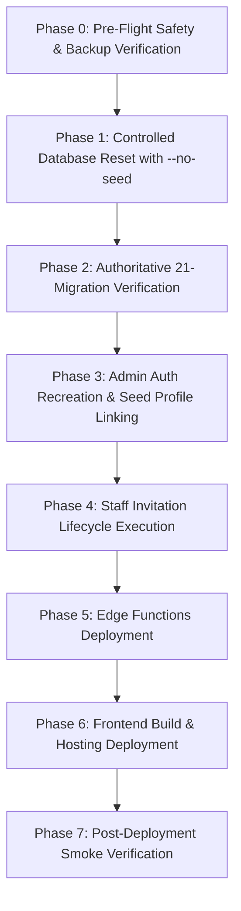

# THE FITNESS HOUSE — FINAL HOSTED REBUILD & DEPLOYMENT RUNBOOK
**Target System:** Hosted Supabase PostgreSQL 17.11
**Project Reference:** `xfagvgypgboplonokntk` (`the-fitness-house-production`)
**Authoritative Local Repository:** `D:\The_Fitness_house_admin_Panel`
**Execution Mode:** Controlled, Step-by-Step Production Rebuild
**Status:** Audit Approved — Execution Ready

---

## 1. Confirmed Production Identities

The following identities have been explicitly authorized for the production environment:
- **Primary Administrator:** `pravinjoshi2707@gmail.com`
- **Operational Staff:** `pratikp5598@gmail.com`

> [!IMPORTANT]
> Do not use generic or placeholder documentation emails (`thefitnesshouse00@gmail.com`, `staff.thefitnesshouse@gmail.com`).
> Newly created accounts receive fresh random UUIDs from Supabase GoTrue; all profile linking is dynamically matched by normalized email.

---

## 2. Rebuild Execution Phases Overview



---

## 3. Phase 0 — Pre-Flight Safety & Verification

Before issuing any command against hosted Supabase:

### 3.1 Verify Pre-Reset Backup on Disk
Confirm the verified pre-reset backup exists and matches its SHA-256 checksum:
```powershell
Get-FileHash -Path "E:\TFH-Database-Backup\tfh-hosted-production-20261103_111744.dump" -Algorithm SHA256
```
- **Expected Hash:** `65173E740E9A18930546C90F1B38562584F7678ED3CDEEDDBEFC0AC9DEEF8A1C`
- **Expected Size:** `482,118 bytes` (~0.46 MB)
- *If missing or checksum does not match, STOP immediately.*

### 3.2 Run Local Read-Only Verification Script
```powershell
node scripts/deployment/verify-deployment-package.js
```
Must report: `TOTAL CHECKS: 16 | PASSED CHECKS: 16 | FAILED CHECKS: 0`.

---

## 4. Phase 1 & 2 — Controlled Hosted Database Reset (With `--no-seed`)

> [!WARNING]
> In Supabase CLI 3.0.0, `npx supabase db reset --remote` drops all `public` objects and **truncates all tables in `auth`** (`users`, `identities`, `sessions`).
> To avoid the catch-22 administrative lockout, **always execute reset with `--no-seed`**.

### Execution Command
Run the remote database reset from the project root:
```powershell
# In D:\The_Fitness_house_admin_Panel
npx supabase db reset --remote --no-seed
```

### What Happens:
1. CLI 3.0.0 executes embedded script `GZe` against `xfagvgypgboplonokntk`.
2. All legacy `public` objects are dropped; `auth.users` and `supabase_migrations` are truncated.
3. All 21 local migrations in `supabase/migrations/` apply sequentially in 4.3 seconds.
4. Schema catalog reaches target state: **18 base tables** (100% RLS enabled), **8 secure views**, **30 RLS policies**, and **8 database triggers**.
5. Seeding is intentionally deferred to Phase 3.

---

## 5. Phase 3 — Administrator Auth Creation & Baseline Seeding

### Step 3.1: Create Administrator in Supabase Auth
1. Open the **Supabase Dashboard** -> Project `xfagvgypgboplonokntk`.
2. Navigate to **Authentication** -> **Users**.
3. Click **Add User** -> **Create User**.
4. Enter:
   - **Email:** `pravinjoshi2707@gmail.com`
   - **Password:** Provide a secure password directly to the owner.
   - **Auto Confirm User:** Checked (Yes).
5. Click **Create User**. Supabase GoTrue generates a new random UUID for the admin.

### Step 3.2: Execute `supabase/seed.sql`

To avoid any unintended migration checks, the **recommended primary method** is direct execution:

#### Recommended Method: Supabase Dashboard SQL Editor (Direct & 100% Migration-Safe)
1. Open **Supabase Dashboard** -> Select Project `xfagvgypgboplonokntk`.
2. Navigate to **SQL Editor** -> Click **New Query**.
3. Copy and paste the entire contents of [`supabase/seed.sql`](file:///D:/The_Fitness_house_admin_Panel/supabase/seed.sql).
4. Click **Run**.
   - *Result: Canonical gym information, 4 membership plans, reminder settings, and the active Admin profile for `pravinjoshi2707@gmail.com` are established with zero migration risk.*

#### CLI Alternative (Verified CLI 3.0.0 Syntax)
If running from the command line, the exact supported flag in Supabase CLI 3.0.0 is `--include-seed` (note: `--seed` is not supported in `db push`):
```powershell
# In D:\The_Fitness_house_admin_Panel
npx supabase db push --remote --include-seed
```
*Note: The CLI verifies that all 21 migrations are already up-to-date (`Schema migrations are up to date.`) and then executes `supabase/seed.sql`.*

### What `seed.sql` Accomplishes:
1. Populates canonical gym information (`The Fitness House`, contact, address in Arag, Maharashtra, INR currency).
2. Populates 4 core membership plans.
3. Sets default reminder thresholds in `reminder_settings`.
4. **Dynamically links the Admin Profile:** Queries `auth.users WHERE lower(trim(email)) = 'pravinjoshi2707@gmail.com'` and inserts `public.profiles` with `role = 'admin'`, `is_active = true`, and the newly generated UUID.

---

## 6. Phase 4 — Staff Invitation Lifecycle Flow

With the administrator active, recreate the staff account through the secure Phase 5 lifecycle:

1. Log into the Fitness House Admin Panel as `pravinjoshi2707@gmail.com`.
2. Navigate to **Staff Management** -> Click **Invite Staff Member**.
3. Enter:
   - **Full Name:** `Pratik Joshi`
   - **Email:** `pratikp5598@gmail.com`
4. Click **Send Invitation**:
   - `create_staff_invitation()` creates an unexpired pending invitation.
   - Supabase GoTrue dispatches an official invitation email to `pratikp5598@gmail.com`.
   - `security_audit_logs` records the invitation event.
5. Staff member opens the email, sets their password, and accepts.
6. Trigger `fn_on_auth_user_created()` verifies the pending invitation, binds `auth_user_id`, sets `role = 'staff'`, and `accept_staff_invitation()` activates the account with `is_active = true`.

---

## 7. Phase 5 — Edge Functions Deployment

Deploy both audited functions to `xfagvgypgboplonokntk`:
```powershell
npx supabase functions deploy invite-staff --project-ref xfagvgypgboplonokntk
npx supabase functions deploy manage-staff-session --project-ref xfagvgypgboplonokntk
```

Verify standard runtime secrets are active (`SUPABASE_URL`, `SUPABASE_ANON_KEY`, `SUPABASE_SERVICE_ROLE_KEY`).

---

## 8. Phase 6 — Frontend Build & Hosting Deployment

```powershell
npm test -- --run
npm run build
```
Deploy the `dist/` production bundle to hosting (e.g. Vercel) with production variables:
- `VITE_SUPABASE_URL=https://xfagvgypgboplonokntk.supabase.co`
- `VITE_SUPABASE_ANON_KEY=<production_anon_key>`

---

## 9. Phase 7 — Post-Deployment Smoke Verification

Execute the 6 tests documented in [`docs/deployment/POST_DEPLOYMENT_SMOKE_TESTS.md`](file:///D:/The_Fitness_house_admin_Panel/docs/deployment/POST_DEPLOYMENT_SMOKE_TESTS.md):
- ST-01: Catalog Check (18 tables, 8 views, 30 policies, 8 triggers).
- ST-02: Admin Dashboard (Revenue, member counts, dues visible).
- ST-03: Staff Role Isolation (0 rows on `payments`/`subscriptions`; dues masked).
- ST-04: Payment Immutability (`UPDATE`/`DELETE` blocked with ERRCODE 27000).
- ST-05: Staff Invitation Workflow (Pending status and audit trail).
- ST-06: Security Safeguards (Last admin protection enforced).

---

## 10. Disaster Recovery & Rollback Runbook

> [!CAUTION]
> **NEVER run `pg_restore --clean` against hosted Supabase without schema scoping.**
> It will attempt to drop system schemas (`auth`, `storage`, `vault`) owned by `supabase_admin`, crashing with permission errors and breaking PostgREST event triggers.

### Option 1: Supabase Platform Point-in-Time Recovery (Recommended)
If a full disaster occurs, use Supabase's native restoration:
1. Open **Supabase Dashboard** -> `xfagvgypgboplonokntk` -> **Database** -> **Backups**.
2. Select the pre-reset backup point and click **Restore**.

### Option 2: Scoped Application Data Recovery (Using Local Dump)
To restore public business data from `E:\TFH-Database-Backup\tfh-hosted-production-20261103_111744.dump`:
```powershell
docker run --rm -v "E:\TFH-Database-Backup:/backups" public.ecr.aws/supabase/postgres:17.11.0.003 `
  pg_restore --clean --if-exists --schema=public --no-owner --no-acl `
  -h db.xfagvgypgboplonokntk.supabase.co -p 5432 -U postgres -d postgres `
  /backups/tfh-hosted-production-20261103_111744.dump
```
- **Scope:** Restores all 16 public tables, views, sequences, members, and subscriptions.
- **Explicit Limitation:** This restores `public` application data only. It does not restore `auth.users` passwords or sessions.
