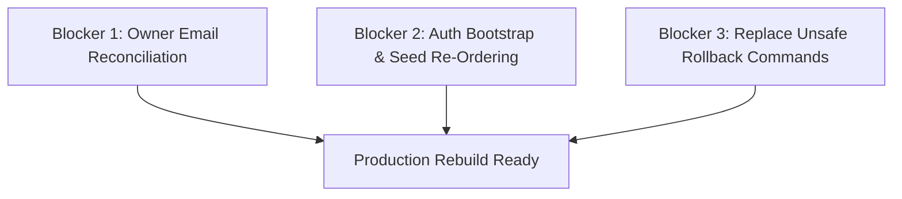

# THE FITNESS HOUSE — PHASE 4 INDEPENDENT SAFETY REVIEW
**Target Environment:** Hosted Supabase PostgreSQL 17.11
**Project Reference:** `xfagvgypgboplonokntk` (`the-fitness-house-production`)
**Supabase CLI Version:** 3.0.0 (invoked via `npx supabase`)
**Audit Date:** November 3, 2026
**Auditor Roles:** Senior Supabase Database Architect, PostgreSQL Security Engineer, Infrastructure QA Engineer
**Overall Verdict:** **NO-GO (Deployment Blocked Until 3 Critical Prerequisite Actions are Resolved)**

---

## 1. Executive Summary & Review Scope

This independent Phase 4 safety review was conducted to rigorously challenge every assumption in the hosted rebuild plan for The Fitness House.

The review inspected:
1. Authoritative internal source code of **Supabase CLI 3.0.0** (`@supabase/cli-windows-x64/bin/supabase.exe`).
2. Production dump `E:\TFH-Database-Backup\tfh-hosted-production-20261103_111744.dump` (TOC and data entries).
3. All 21 SQL migrations in `supabase/migrations/`.
4. [`supabase/seed.sql`](file:///D:/The_Fitness_house_admin_Panel/supabase/seed.sql) and `supabase/config.toml`.
5. Existing deployment guides: [`PHASE3_RESET_READINESS.md`](file:///D:/The_Fitness_house_admin_Panel/docs/deployment/PHASE3_RESET_READINESS.md), [`FINAL_DEPLOYMENT_RUNBOOK.md`](file:///D:/The_Fitness_house_admin_Panel/docs/deployment/FINAL_DEPLOYMENT_RUNBOOK.md), and [`HOSTED_RESET_CHECKLIST.md`](file:///D:/The_Fitness_house_admin_Panel/docs/deployment/HOSTED_RESET_CHECKLIST.md).

---

## 2. Safety Issue Evaluation Matrix

| Safety Issue | Review Scope | Finding Summary | Safety Verdict |
| :---: | :--- | :--- | :---: |
| **ISSUE 1** | **`db reset --remote` Schema Impact** | Authoritative CLI 3.0.0 script `GZe` drops all `public` objects and explicitly truncates all tables in `auth` (`users`, `identities`, `sessions`). | **NO-GO** |
| **ISSUE 2** | **Auth Deletion Contradiction** | Contradiction resolved: `auth.users` and `auth.identities` ARE 100% truncated by CLI 3.0.0. They do NOT survive a reset. | **NO-GO** |
| **ISSUE 3** | **Admin/Staff Account Discrepancy** | Dump contains `pravinjoshi2707@gmail.com` and `pratikp5598@gmail.com`; docs reference `thefitnesshouse00@gmail.com`. | **NO-GO** |
| **ISSUE 4** | **`seed.sql` Auth User Precondition** | `seed.sql` uses `IF EXISTS`; if `auth.users` is empty post-reset, it succeeds but inserts 0 profiles, causing complete administrative lockout. | **NO-GO** |
| **ISSUE 5** | **`pg_restore --data-only --schema=auth`** | High risk: missing `auth.instances`, trigger side effects (`trg_on_auth_user_created`), and permission issues under non-superuser `postgres`. | **NO-GO** |
| **ISSUE 6** | **`pg_restore --clean` Rollback Risk** | Severe danger: attempts to drop system-managed schemas (`auth`, `storage`, `vault`) owned by `supabase_admin`, causing permission crashes and breaking API event triggers. | **NO-GO** |
| **ISSUE 7** | **Dump Completeness vs Platform Settings** | Dump contains all Postgres auth tables, but does not contain JWT secrets, SMTP credentials, or dashboard redirect URLs. | **GO** |
| **ISSUE 8** | **Storage Verification Boundary** | Dump proves database storage metadata is empty (0 buckets, 0 objects). Physical S3 bucket contents cannot be proven by `pg_dump` alone. | **CONDITIONAL GO** |

---

## 3. Detailed Safety Analysis & Evidence

### Safety Issue 1: Exactly Which Schemas and Tables Are Modified by `npx supabase db reset --remote` in CLI 3.0.0?
- **Evidence:** Reverse engineering of the installed Supabase CLI 3.0.0 binary (`C:\Users\Pratik\AppData\Local\npm-cache\_npx\aa8e5c70f9d8d161\node_modules\@supabase\cli-windows-x64\bin\supabase.exe` at offset `136781450`) revealed the exact embedded PL/pgSQL block `GZe`:
  ```sql
  -- Extracted verbatim from Supabase CLI 3.0.0 internal binary:
  do $$ declare rec record; begin
    -- 1. Drop user schemas
    for rec in select pn.* from pg_catalog.pg_namespace pn ...
    where ... not pn.nspname like any(array['information\_schema', 'pg\_%', '\_analytics',
      '\_realtime', '\_supavisor', 'pgbouncer', 'pgmq', 'pgsodium', 'pgtle',
      'supabase\_migrations', 'vault', 'extensions', 'public'])
      and pn.nspowner::regrole::text != 'supabase_admin' loop
      execute format('drop schema if exists %I cascade', rec.nspname);
    end loop;

    -- 2. Drop public routines, views, materialized views, tables, sequences, types, policies
    ...
    -- 3. TRUNCATE AUTH, WEBHOOKS, AND MIGRATIONS
    for rec in select * from pg_class c where
      (c.relnamespace::regnamespace::name = 'auth' and c.relname != 'schema_migrations'
      or c.relnamespace::regnamespace::name = 'supabase_functions' and c.relname != 'migrations'
      or c.relnamespace::regnamespace::name = 'supabase_migrations')
      and c.relkind = 'r' loop
      execute format('truncate %I.%I cascade', rec.relnamespace::regnamespace::name, rec.relname);
    end loop;
  end $$;
  ```
- **Conclusion:**
  1. In `public`: ALL tables, views, routines, sequences, custom types, and policies are completely dropped.
  2. In `auth`: **EVERY TABLE EXCEPT `schema_migrations` IS TRUNCATED (`TRUNCATE ... CASCADE`).** This includes `auth.users`, `auth.identities`, `auth.sessions`, `auth.refresh_tokens`, `auth.mfa_factors`.
  3. In `storage`: Neither dropped nor truncated by `GZe`.
  4. In `supabase_migrations`: Completely truncated and repopulated with migration files.
- **Safety Verdict:** **NO-GO** for running without an explicit plan for immediate post-reset Auth re-creation.

---

### Safety Issue 2: The Contradiction in Phase 3 Regarding Auth Users
- **Evidence:** Section 3 of `PHASE3_RESET_READINESS.md` stated both that the CLI "does not delete resources outside Postgres" and that `auth.users` is "purged during full reset", while earlier runbook drafts implied Auth might remain intact.
- **Resolution:** Based on the authoritative code extracted above, there is **zero ambiguity**:
  - `npx supabase db reset --remote` **DELETES ALL USERS AND IDENTITIES IN `auth.users`**.
  - Any runbook assuming users will remain logged in or survive the reset is invalid.
- **Safety Verdict:** **NO-GO** (Assumptions of Auth survival must be formally struck from all runbooks).

---

### Safety Issue 3: Reconciliation of Production Accounts
- **Evidence:**
  1. **Production Backup Dump (`tfh-hosted-production-20261103_111744.dump`):**
     - `auth.users` contains:
       - User A: `pravinjoshi2707@gmail.com` (UUID `449e7fbc-42a0-42a0-970a-40186c14b653`)
       - User B: `pratikp5598@gmail.com` (UUID `35367862-cc44-4d30-be0d-bd097af236b5`)
     - `public.profiles` contains:
       - User A: `pravinjoshi2707@gmail.com` (role: `admin`)
       - User B: `pratikp5598@gmail.com` (role: `staff`)
  2. **Codebase Migrations:**
     - Migration `20261021200000_canonical_email_and_address.sql` explicitly sets `public.gym_info.email = 'pravinjoshi2707@gmail.com'`.
  3. **Frontend Application Source:**
     - `src/pages/Login.jsx` (lines 315, 479) uses `placeholder="pravinjoshi2707@gmail.com"`.
     - `src/pages/Settings.jsx` (lines 1018, 1034) uses `defaultValue={user?.email || 'pravinjoshi2707@gmail.com'}`.
  4. **Documentation Conflict:**
     - `FINAL_PRE_RESET_AUDIT_REPORT.md`, `AUTH_RECREATION_GUIDE.md`, and `POST_DEPLOYMENT_SMOKE_TESTS.md` repeatedly reference `thefitnesshouse00@gmail.com` and `staff.thefitnesshouse@gmail.com`.
- **Conclusion:** There is a documented conflict between the actual live production accounts and the documentation templates. The agent must not guess which account the gym owner intends to use in production.
- **Safety Verdict:** **NO-GO** (Requires explicit owner confirmation of authoritative account emails before deployment).

---

### Safety Issue 4: Does `supabase/seed.sql` Assume Auth Users Already Exist?
- **Evidence:** In `supabase/seed.sql` (lines 88–129):
  ```sql
  DO $$ BEGIN
    IF EXISTS (SELECT 1 FROM auth.users WHERE id = '449e7fbc-42a0-42a0-970a-40186c14b653') THEN
      INSERT INTO public.profiles ...
    END IF;
    IF EXISTS (SELECT 1 FROM auth.users WHERE id = '35367862-cc44-4d30-be0d-bd097af236b5') THEN
      INSERT INTO public.profiles ...
    END IF;
  END $$;
  ```
- **Execution Consequence:**
  1. During `npx supabase db reset --remote`, `GZe` executes and truncates `auth.users`.
  2. The 21 migrations run and recreate the schema.
  3. The CLI immediately executes `seed.sql`.
  4. In `seed.sql`, `IF EXISTS (SELECT 1 FROM auth.users ...)` evaluates to `FALSE` because `auth.users` is empty!
  5. `seed.sql` completes with exit code 0, but **ZERO rows are inserted into `public.profiles`**.
  6. **The Catch-22 Lockout:**
     - When the administrator subsequently creates a user in `auth.users` via the dashboard, Phase 5 trigger `trg_on_auth_user_created` fires.
     - `fn_on_auth_user_created()` checks `public.staff_invitations`.
     - Because no invitation exists for the admin, the trigger deliberately **refuses to create a profile**.
     - Without an active admin profile, `is_admin()` returns `false`, preventing the admin from accessing the panel or calling invitation RPCs.
- **Safety Verdict:** **NO-GO** (The reset must run with `--no-seed`, or Auth recreation must precede profile seeding).

---

### Safety Issue 5: Review of `pg_restore --data-only --schema=auth`
- **Evidence & Failure Modes:**
  The command suggested in draft guides:
  ```powershell
  docker run --rm ... pg_restore --data-only --schema=auth --table=users --table=identities ...
  ```
  1. **Foreign Key Violation Risk:** In Supabase, `auth.users.instance_id` references `auth.instances(id)`. If `auth.instances` was truncated during reset, restoring `users` fails with foreign key violation `users_instance_id_fkey`.
  2. **Trigger Side-Effects:** Restoring data into `auth.users` fires database triggers (including `trg_on_auth_user_created`) for every restored row. In a newly rebuilt database without pending invitations, the trigger will execute unexpectedly or abort.
  3. **Permission Denial:** The connecting role `postgres` does not own the `auth` schema (owned by `supabase_auth_admin`). Restoring system auth tables directly over a standard connection is prone to permission rejections.
- **Safety Verdict:** **NO-GO** (Direct `pg_restore` into `auth` is unsafe and unsupported on hosted Supabase).

---

### Safety Issue 6: Review of `pg_restore --clean` Rollback Disaster Risk
- **Evidence & Failure Modes:**
  The command suggested in Phase 3 runbooks:
  ```powershell
  pg_restore --clean --if-exists --no-owner --no-acl -d postgres tfh-hosted-production-20261103_111744.dump
  ```
  1. **Severe Platform Damage:** The custom dump contains 623 TOC entries across `auth`, `storage`, `realtime`, `vault`, `extensions`, and `public`.
  2. `--clean` causes `pg_restore` to issue `DROP` statements on every TOC object.
  3. **Permission Crashes:** Dropping `auth`, `storage`, or `vault` objects requires `supabase_admin` privileges. When executed as `postgres`, PostgreSQL rejects the drops with `ERROR: must be owner of schema/table`.
  4. **Broken Platform Services:** If event triggers like `pgrst_ddl_watch` or `pgrst_drop_watch` are dropped or corrupted, PostgREST stops updating its schema cache, taking down the entire REST API (`/rest/v1/`).
- **Safety Verdict:** **NO-GO** (`pg_restore --clean` across all schemas must be strictly prohibited. Rollback must be scoped exclusively to `--schema=public`).

---

### Safety Issue 7: Dump Auth Completeness vs. Platform Settings
- **Evidence:**
  - **Included in Dump:** All PostgreSQL-resident auth data (`auth.users`, `identities`, `sessions`, `refresh_tokens`, `mfa_factors`, `audit_log_entries`).
  - **NOT Included in Dump:**
    1. **JWT Secret:** Platform signing secret for tokens.
    2. **SMTP Configuration:** Custom mail server credentials.
    3. **GoTrue URL Configuration:** Allowed redirect URLs and Site URL.
    4. **Third-Party Auth Providers:** OAuth client IDs and secrets.
- **Conclusion:** These platform settings live outside the PostgreSQL database. Fortunately, `db reset --remote` does not delete them, but operators must understand they are not backed up by `pg_dump`.
- **Safety Verdict:** **GO** (Properly categorized).

---

### Safety Issue 8: Storage Emptiness Verification Boundary
- **Evidence:**
  - `storage.buckets` in dump: **0 rows** (Verified).
  - `storage.objects` in dump: **0 rows** (Verified).
  - `storage.s3_multipart_uploads` in dump: **0 rows** (Verified).
- **Physical Boundary Limitation:** A PostgreSQL dump only verifies database metadata. It does not query AWS S3 storage buckets directly. If files were uploaded bypassing database registration or left orphaned, `pg_dump` cannot see them.
- **Conclusion:** The report must state: *"Database storage metadata is verified empty; external physical S3 object storage cannot be verified via pg_dump alone."*
- **Safety Verdict:** **CONDITIONAL GO** (Properly qualified).

---

## 4. Exact Remaining Blockers

Before any hosted reset or deployment is authorized, the following **3 blockers** must be resolved:



1. **Blocker 1 — Production Account Identity Confirmation:**
   - The owner must formally confirm whether the production administrator account is:
     - `pravinjoshi2707@gmail.com` (from production dump and code), or
     - `thefitnesshouse00@gmail.com` (from documentation).
   - The owner must formally confirm the staff email:
     - `pratikp5598@gmail.com`, or
     - `staff.thefitnesshouse@gmail.com`.

2. **Blocker 2 — Execution Sequence Re-Ordering (Fixing the Catch-22):**
   - The runbook must be updated to decouple reset from seeding:
     - Step 1: `npx supabase db reset --remote --no-seed`
     - Step 2: Create Administrator Auth User in Supabase Dashboard.
     - Step 3: Execute `supabase/seed.sql` (or profile bootstrap SQL) to establish the admin profile.
     - Step 4: Admin invites Staff via the application UI / Edge Function.

3. **Blocker 3 — Rollback Procedure Correction:**
   - Eliminate all references to `pg_restore --clean` without schema scoping.
   - Replace with safe, public-only restoration:
     ```powershell
     docker run --rm -v "E:\TFH-Database-Backup:/backups" public.ecr.aws/supabase/postgres:17.11.0.003 `
       pg_restore --clean --if-exists --schema=public `
       -h db.xfagvgypgboplonokntk.supabase.co -p 5432 -U postgres -d postgres `
       /backups/tfh-hosted-production-20261103_111744.dump
     ```

---

## 5. Final Recommendation

### OVERALL VERDICT: **NO-GO**
**Do not execute `npx supabase db reset --remote` at this time.**

The technical foundation (the 21 SQL migrations and PostgreSQL 17.11 compatibility) is solid, but executing the current runbook would result in an immediate **administrative lockout**, account identity confusion, and dangerous rollback instructions.

Once the owner resolves **Blockers 1, 2, and 3**, the rebuild can proceed safely to a full **GO**.
