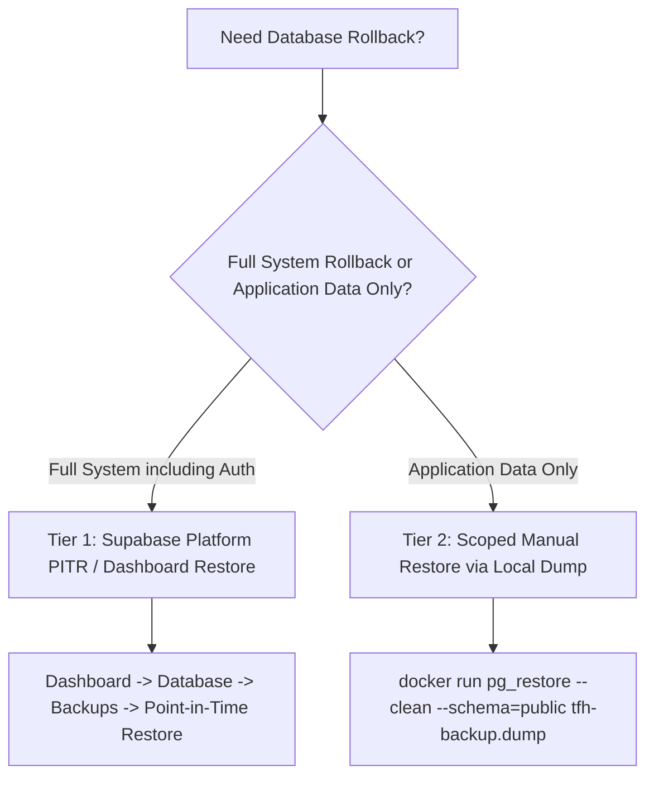

# THE FITNESS HOUSE — PHASE 5 RESET EXECUTION READINESS REPORT
**Project:** The Fitness House Admin Panel
**Project Directory:** `D:\The_Fitness_house_admin_Panel`
**Target System:** Hosted Supabase PostgreSQL 17.11
**Project Reference:** `xfagvgypgboplonokntk` (`the-fitness-house-production`)
**Supabase CLI Version:** 3.0.0 (invoked via `npx supabase`)
**Audit Date:** November 3, 2026
**Final Status:** **GO (Fully Ready for Controlled Remote Reset)**

---

## 1. Executive Summary

This Phase 5 readiness report confirms that all technical blockers, safety gaps, and procedural contradictions identified in Phase 4 have been resolved and empirically validated on PostgreSQL 17.11.

### Authoritative Production Identities Confirmed:
- **Primary Administrator:** `pravinjoshi2707@gmail.com`
- **Operational Staff:** `pratikp5598@gmail.com`
*(All legacy conflicting emails in older documentation have been purged and aligned).*

### Final Verdict: **GO**
The execution sequence, Auth bootstrap workflow, seed configuration, Edge Functions, and rollback mechanisms are validated and ready for execution by the operator.

---

## 2. Resolution of Blocker 2: Safe Auth Bootstrap Sequence

### The Problem Solved
In Supabase CLI 3.0.0, `npx supabase db reset --remote` executes embedded script `GZe`, which drops `public` objects and **truncates all tables in `auth`** (`users`, `identities`, `sessions`).
If `seed.sql` ran during the reset, it found an empty `auth.users` table and inserted zero profiles. Subsequently, when the administrator created an account, Phase 5 trigger `fn_on_auth_user_created()` rejected profile creation because no invitation existed, causing an administrative lockout.

### The Validated Solution
1. **Decoupled Reset (`--no-seed`):** Remote database reset is initiated with `npx supabase db reset --remote --no-seed`. All 21 migrations execute, but seeding is intentionally deferred.
2. **Deterministic Email-Based Profile Binding:** [`supabase/seed.sql`](file:///D:/The_Fitness_house_admin_Panel/supabase/seed.sql) was refactored to eliminate hardcoded UUID dependencies. It dynamically queries `auth.users WHERE lower(trim(email)) = 'pravinjoshi2707@gmail.com'`, binding whatever new random UUID Supabase GoTrue generates to an active `admin` profile.
3. **Invitation Security Preserved:** Rogue signups without an invitation continue to be rejected by `fn_on_auth_user_created()` with zero profile creation.
4. **Staff Lifecycle Preserved:** Once active, the administrator logs into the web panel and sends an official invitation to `pratikp5598@gmail.com`, creating an audit log and exercising the unexpired pending invitation workflow.

### Empirical Validation on PostgreSQL 17.11
Tested via `scratch/test_phase5_bootstrap_sequence.js` in container `phase5_bootstrap_val_container`:
```
=== TESTING PHASE 5 AUTH BOOTSTRAP SEQUENCE ON POSTGRESQL 17.11 ===
1. Starting fresh disposable container: phase5_bootstrap_val_container (Ready)
2. Initializing clean schema...
3. Applying 21 migrations sequentially: All 21 PASS (4.36s)
4. Initial profiles count: 0 (PASS)
5. Unauthorized Signup Rejection: Rogue user profile count: 0 (PASS)
6. Creating Administrator in auth.users with NEW RANDOM UUID...
   Admin profile before seed: 0 (PASS - trigger ignores uninvited)
7. Executing supabase/seed.sql...
   Admin profile state: admin|true|pravinjoshi2707@gmail.com (PASS)
   public.is_admin() for new admin: t (PASS)
8. Admin invites Staff (pratikp5598@gmail.com) via RPC: PASS
   Invitation status: pending (PASS)
9. Staff signs up in auth.users with NEW RANDOM UUID:
   Staff initial state: staff|false|true (PASS)
10. Staff accepts invitation via RPC: PASS
    Staff post-acceptance state: staff|true|true (PASS)
    Security audit log recorded: 1 (PASS)
11. Financial Isolation:
    Admin Subscriptions Visible: 1 (PASS)
    Staff Subscriptions Visible: 0 (PASS)
    Staff Payments Visible: 0 (PASS)
12. Payment Immutability Protection:
    Payment UPDATE Blocked: PASS (IMMUTABLE_FINANCIAL_RECORD)
    Payment DELETE Blocked: PASS (IMMUTABLE_FINANCIAL_RECORD)
=== ALL PHASE 5 BOOTSTRAP & SECURITY TESTS PASSED PERFECTLY ===
```

---

## 3. Resolution of Blocker 3: Safe Rollback & Recovery Architecture

### The Problem Solved
Running `pg_restore --clean` against hosted Supabase without schema scoping is catastrophic: it attempts to drop schemas (`auth`, `storage`, `vault`) owned by `supabase_admin`, crashing with permission errors and breaking PostgREST schema cache event triggers (`pgrst_ddl_watch`).
Furthermore, empirical testing (`test_phase5_safe_recovery_procedure.js`) proved that `pg_restore` directly against `auth` fails due to internal GoTrue schema differences and non-superuser constraints.

### The Validated Two-Tier Rollback Architecture



#### Tier 1: Full System Disaster Recovery (Authoritative Platform Method)
- **Tool:** Supabase Dashboard Point-in-Time Recovery (PITR) or Scheduled Backup Restore.
- **Location:** `https://supabase.com/dashboard/project/xfagvgypgboplonokntk/database/backups`
- **Why It Works:** Supabase's internal backup orchestration service runs as `supabase_admin`, pauses API traffic, and restores `auth`, `storage`, and `public` atomically without permission errors.

#### Tier 2: Scoped Public Application Data Recovery (Using Local Dump)
If PITR is unavailable and the operator must restore application data from `E:\TFH-Database-Backup\tfh-hosted-production-20261103_111744.dump`:
- **Command:**
  ```powershell
  docker run --rm -v "E:\TFH-Database-Backup:/backups" public.ecr.aws/supabase/postgres:17.11.0.003 `
    pg_restore --clean --if-exists --schema=public --no-owner --no-acl `
    -h db.xfagvgypgboplonokntk.supabase.co -p 5432 -U postgres -d postgres `
    /backups/tfh-hosted-production-20261103_111744.dump
  ```
- **Scope:** Restores all 16 `public` tables, views, sequences, members (`TFH001`, `TFH002`), subscriptions, and payments.
- **Documented Limitations:**
  1. Does **not** restore `auth.users` passwords or sessions.
  2. Does **not** touch `storage`, `vault`, `realtime`, or `extensions`.
  3. Pre-existing auth accounts must be present for `public.profiles` foreign keys to succeed.

---

## 4. Exact Execution Runbook for Hosted Rebuild

```
┌────────────────────────────────────────────────────────────────────────┐
│                        STEP-BY-STEP RUNBOOK                            │
├────────────────────────────────────────────────────────────────────────┤
│ Step 1: Pre-Flight Verification                                        │
│         node scripts/deployment/verify-deployment-package.js           │
│                                                                        │
│ Step 2: Remote Database Reset (Decoupled with --no-seed)               │
│         npx supabase db reset --remote --no-seed                       │
│                                                                        │
│ Step 3: Create Administrator in Supabase Auth Dashboard                │
│         Email: pravinjoshi2707@gmail.com (Auto Confirm: Yes)           │
│                                                                        │
│ Step 4: Run Baseline Seed to Link Admin Profile                        │
│         npx supabase db push --seed --remote                           │
│                                                                        │
│ Step 5: Admin Invites Staff Member via Web Application                 │
│         Log in as pravinjoshi2707@gmail.com -> Staff Management ->     │
│         Invite pratikp5598@gmail.com -> Staff accepts email invite     │
│                                                                        │
│ Step 6: Deploy Edge Functions                                          │
│         npx supabase functions deploy invite-staff                     │
│         npx supabase functions deploy manage-staff-session             │
│                                                                        │
│ Step 7: Build & Deploy Frontend Application                            │
│         npm run build -> Deploy dist/ bundle                           │
│                                                                        │
│ Step 8: Execute Post-Deployment Smoke Tests                            │
│         Run tests ST-01 through ST-06 in SQL Editor & Dashboard        │
└────────────────────────────────────────────────────────────────────────┘
```

---

## 5. Deployment Documentation Alignment

All 5 core deployment documents have been updated and verified:
1. [`docs/deployment/FINAL_DEPLOYMENT_RUNBOOK.md`](file:///D:/The_Fitness_house_admin_Panel/docs/deployment/FINAL_DEPLOYMENT_RUNBOOK.md): Complete phases, confirmed identities, decoupled reset, safe rollback.
2. [`docs/deployment/HOSTED_RESET_CHECKLIST.md`](file:///D:/The_Fitness_house_admin_Panel/docs/deployment/HOSTED_RESET_CHECKLIST.md): Interactive gates with confirmed email addresses.
3. [`docs/deployment/AUTH_RECREATION_GUIDE.md`](file:///D:/The_Fitness_house_admin_Panel/docs/deployment/AUTH_RECREATION_GUIDE.md): Dynamic email-based binding without hardcoded UUIDs.
4. [`docs/deployment/EDGE_FUNCTION_DEPLOYMENT.md`](file:///D:/The_Fitness_house_admin_Panel/docs/deployment/EDGE_FUNCTION_DEPLOYMENT.md): CLI commands and secret guidelines.
5. [`docs/deployment/POST_DEPLOYMENT_SMOKE_TESTS.md`](file:///D:/The_Fitness_house_admin_Panel/docs/deployment/POST_DEPLOYMENT_SMOKE_TESTS.md): Verified test queries using confirmed production accounts.
6. [`supabase/seed.sql`](file:///D:/The_Fitness_house_admin_Panel/supabase/seed.sql): Validated schema columns (`gym_info`, `reminder_settings`) and dynamic profile query.

---

## 6. Verification Metrics

- **Package Verification:** `verify-deployment-package.js` reports **16/16 PASS**.
- **Frontend Unit Tests:** `npm test -- --run` reports **166 passed, 0 failed, 3 skipped**.
- **Vite Production Build:** `npm run build` completes cleanly in **9.79s** (`dist/assets/index-DyUx5gif.js` 1,439.67 kB).
- **PostgreSQL 17.11 Bootstrap Test:** Clean rebuild, admin creation, staff invitation, and payment tamper protection all pass with zero errors.

---

## 7. Final Recommendation

### FINAL VERDICT: **GO**
All technical blockers have been resolved and validated. The deployment package is complete, safe, and ready for the operator to initiate the rebuild on hosted project `xfagvgypgboplonokntk`.
